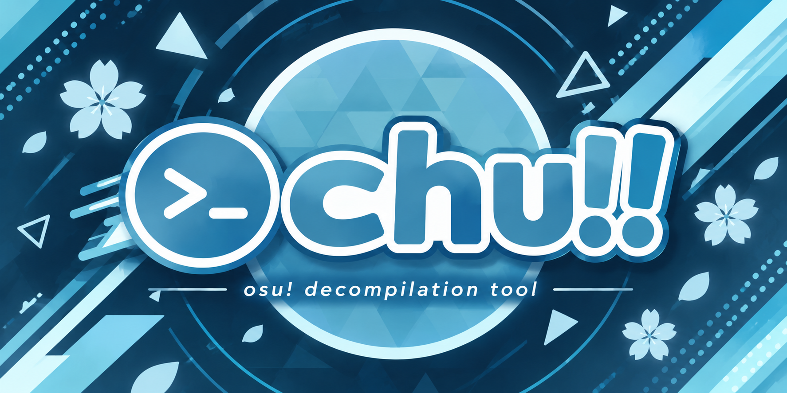

<p align="center"></p>

# ochu!!

A matching decompilation of the legacy osu! client ("stable"), made for archival and study.

**The repository does not hold the game's source.** It holds the tool that writes it on your
machine, from your own copy of the game: give it your osu! folder, it gives you `src/`.

- **Reference build**: `osu!.exe` 1.3.3.8. The SHA-256 of every binary of that build is in
  [`game.sha256`](game.sha256). No other build can be used: the tables describe that one.
- **Goal**: `src/`, recompiled, gives back the original IL of every method.
- **Status**: the generated `src/` compiles and **100 %** of the 19672 methods match. 19662 are
  decompiled to C# (99.95 %); 10 methods of the obfuscator's runtime have no C# form and are
  kept as IL. The build is one `osu!.exe` with the 32 managed resources of the reference.
  [`src.sha256`](src.sha256) lists the SHA-256 of the 1810 files of `src/`, so that a machine
  can tell whether it generated the same source as the reference one.
- **Naming**: about 21000 symbols are named in [`docs/names.tsv`](docs/names.tsv), each with
  its evidence; a note that ends with `?` is an inference. About 270 keep a generic name
  (`Class123`). Names have no effect on the IL.

The rate is the one of the project's own comparison, which reads a few encodings as
equivalent because the obfuscator rewrote them. What it covers and what it does not is in
[`docs/matching.md`](docs/matching.md); how the binary becomes `src/` is in
[`docs/pipeline.md`](docs/pipeline.md).

## Legal

This project is not affiliated with, authorized by or endorsed by ppy Pty Ltd. osu! is their
work, distributed under the [osu! terms of service](https://osu.ppy.sh/legal/en/Terms); the
"stable" client is proprietary and closed source.

- **The `src/` you generate is not open source.** It is the publisher's code, and that of
  the third parties listed in [`THIRD-PARTY-NOTICES.md`](THIRD-PARTY-NOTICES.md), in
  decompiled form. Their copyright is untouched and no license is granted on it: it is for
  your own study; do not publish it, redistribute it or build a product from it.
- The project's own work (`app/`, `scripts/`, `build/`, `docs/`) is under the MIT license,
  within the scope written at the top of [`LICENSE`](LICENSE). It does not extend to `src/`.
- The repository holds no game binary, no source code of the game, no game asset and no
  account data: text, and the project's own images under `assets/` and `app/assets/`. You
  need your own copy of the reference build, obtained from its publisher.
- The purpose is preservation, study and interoperability research, without commercial use.
  Cheating, tooling that gets around the game's anti-cheat, taking a rebuilt client online
  and distributing builds are out of scope and not accepted.
- A rights holder who wants material removed only has to ask: see [`LEGAL.md`](LEGAL.md),
  which is the full notice.

## Layout

| Path | In git | Role |
|---|---|---|
| `game/` | no | Your copy of the reference build. **Read-only**: every tool works on a copy under `work/`. |
| `game.sha256` | yes | SHA-256 of the binaries of the reference build. |
| `tools/` | no | Third-party tools downloaded by `scripts/setup-tools.ps1`. |
| `work/` | no | Regenerable output: deobfuscated binaries, raw decompiler output, builds, reports. |
| `src/` | no | The decompiled source, and `src/il/unit.il` for the methods kept as IL. **Generated** from your copy of the game: never edited by hand, never published. |
| `src.sha256` | yes | SHA-256 of every file of the generated `src/`: hashes and file names, no code. |
| `app/` | yes | The program (Rust): the window `ochu.exe` and the console `ochu-cli.exe`. It finds and checks the game copy, downloads the pinned tools, runs the pipeline and writes `src/`. |
| `build/` | yes | The project that recompiles `src/`. |
| `assets/` | yes | The project's own banner and logo. Nothing from the game. |
| `LEGAL.md`, `THIRD-PARTY-NOTICES.md`, `LICENSE` | yes | Whose work each part is, what may be done with it, how to ask for a removal. |
| `docs/` | yes | Two documents, and the tables the pipeline reads (`names.tsv`, `fixups.tsv`, `decompiler-hints.tsv`, `units.tsv`, `vm-*.tsv`). |
| `scripts/` | yes | The stages of the pipeline that work on .NET metadata, the build, the comparison tools. |

## Get the source

Windows 10 or 11 only, with what Windows ships (Windows PowerShell 5.1, the .NET Framework
4.x) and an osu! folder that holds the reference build.

`ochu.exe` is built from `app/` by `scripts\build-app.ps1` (see below); a release of the
repository, when there is one, carries it ready to run. Start it. It looks for your osu!
installation (or you point it at the folder), checks that it is the reference build, and
asks for an empty folder to work in. Then it
downloads the tools it needs (de4dot-cex, and a private copy of the .NET SDK 8 if the machine
has none: nothing is installed system-wide), runs the pipeline and checks the result against
`src.sha256`. The source is in the `src` subfolder of that folder, after about three minutes;
the folder takes about 350 MB, 1.2 GB with the private .NET SDK. The option "rebuild and
compare" also recompiles it and prints the matching rate.

Your game folder is only read, and the game is never started. The same run from a console:

```powershell
.\ochu-cli.exe generate --out C:\somewhere\empty [--game <osu! folder>] [--check]
```

## Work on the project

Needed on top: Git, the .NET SDK 8.0.4xx (`global.json`) and Rust (`rustup`; the version is
pinned in `app/rust-toolchain.toml`). The .NET Framework's `csc.exe` and `ilasm.exe` build
two small compilation units.

Put your copy of the reference build in `game/`, hidden files included (the game's DLLs are
hidden), then:

```powershell
.\scripts\game-manifest.ps1 -Verify -Core  # game/ holds the reference build
.\scripts\setup-tools.ps1                  # pinned tools into tools/
.\scripts\build-app.ps1                    # app/ -> work/app/release/ochu.exe, ochu-cli.exe
.\scripts\pipeline.ps1                     # game/ -> work/ -> src/ (about 2 minutes)
.\work\app\release\ochu-cli.exe src-manifest --verify   # src/ is the reference source
.\scripts\build.ps1                        # src/ -> work/build/linked/osu!.exe
.\scripts\match.ps1                        # the matching rate
```

On a working machine `src-manifest --verify` reports no difference and `match.ps1` prints
the rate given above. If PowerShell refuses to run the scripts:
`powershell -ExecutionPolicy Bypass -File <script>`.

The scripts do not run on macOS or Linux: decrypting the strings executes the game's own
decryptor in a 32-bit .NET Framework. Use a Windows virtual machine.

With Claude Code, the `/setup-toolchain` skill (`.claude/skills/setup-toolchain`) walks through
this setup and checks its result.

## Toolchain

Versions are pinned, with the hash of each download, in `scripts/setup-tools.ps1`; the two
downloads of the program are pinned in `app/src/tools.rs`.

| Tool | Version | Use |
|---|---|---|
| ICSharpCode.Decompiler | 9.1.0.7988 | the decompiler engine behind `scripts/decompiler` |
| Roslyn (`Microsoft.Net.Compilers.Toolset`) | 3.11.0 | the compiler of the matching build (`build/osu.csproj`) |
| Rust | 1.96.0 | builds `app/`; its crates are pinned by `app/Cargo.lock` |
| de4dot-cex | 4.0.0 | generic renaming of invalid names; its `dnlib` is the metadata library of the scripts |

## Working rules

1. `game/` never changes. Every transformation starts from a copy under `work/`.
2. `work/` is disposable: a script must be able to regenerate everything in it.
3. No game binary, no source code of the game, no game asset, no account data in git: text,
   and the project's own images.
4. `src/` is an output, and it stays on your machine. Names are fixed in `docs/names.tsv`, the rest in the decompiler or in
   `docs/fixups.tsv`, and the pipeline writes `src/` again.
5. Launching the game, original or rebuilt, connects to the osu! servers with your account.
   The rebuilt program is not the official client: never take it online.
